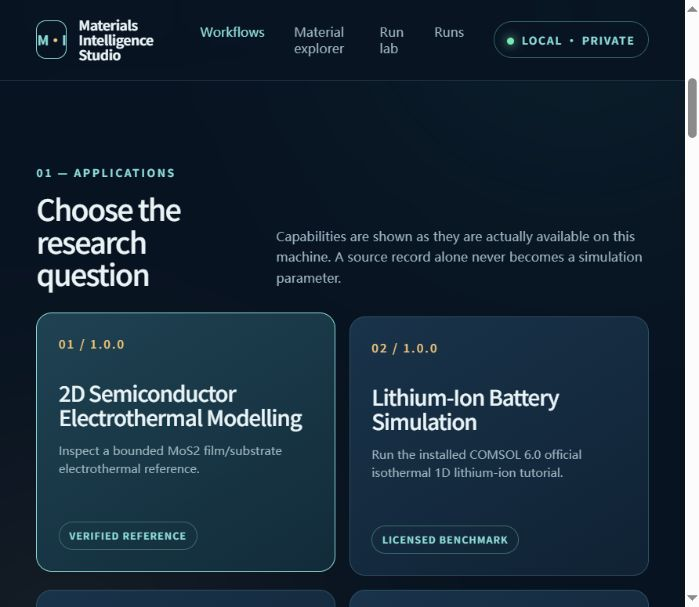
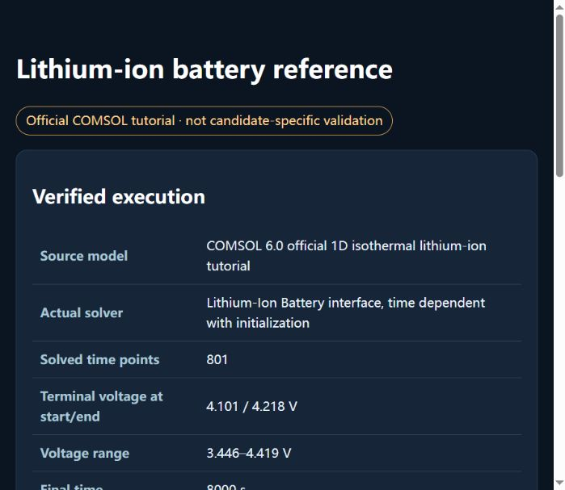

# Materials Intelligence Studio: simulation user guide

**Scope:** local Studio workflow on the configured Windows research workstation. The public professor demo provides a browser calculation of the illustrative V1 1D heat equation and a gallery of existing results. It does not host COMSOL, MATLAB, the private C2DB database or unpublished measurements.

## 1. Launch and choose a case

From the project root, with the configured Python environment:

```powershell
.venv\Scripts\python.exe app\materials_intelligence_studio.py --port 8766
```

Open `http://127.0.0.1:8766/` on the same computer. The server deliberately binds to localhost. In **Workflows**, choose one of the registered application cards. The runnable references are:

| Reference | What COMSOL does | What MATLAB does | Status boundary |
| --- | --- | --- | --- |
| MoS₂ electrothermal | Hash-checks and reuses an existing solved V5 MPH; no new solve is claimed | Runs the V6 sensitivity and identifiability analysis | Literature-informed/illustrative; no Fe-containing-device validation |
| Lithium-ion battery | Genuinely solves, saves and reopens the installed COMSOL 6.0 1D carbon/LMO tutorial; an isolated tolerance check is also solved | Reconstructs the prescribed current and integrates exported current for areal charge accounting | Official tutorial, not an LG M50 or C2DB-derived cell |
| LG M50 research candidate | Existing independent COMSOL candidate is available for audit, but normal production execution remains **BLOCKED** | Existing V3.3/V3.4 comparisons are viewable | Exact equation equivalence and independent cell validation are unestablished |



## 2. Inspect the evidence gate

In **Run lab**, inspect the selected material identity, declared model, parameter source, assumptions, licence check and missing evidence. Accept the illustrative assumptions when the interface requests it. Click **Check parameter evidence**. A `READY` gate means this *registered reference execution* can proceed under its declared conditions; it does not mean a new material has been validated. An arbitrary C2DB UID supplies neither thermal boundary conditions nor battery transport/kinetic parameters and should remain blocked.

The published Chen2020 LG M50 case is a separate research transfer. Its COMSOL/PyBaMM numerical comparison is not a replacement for the official tutorial workflow, and the UI's LG M50 production gate must remain `BLOCKED`.

## 3. Create, run and inspect

1. When the reference gate is `READY`, click **Create isolated run**.
2. Open **Runs**, select the new run and click **Launch authorised workflow**.
3. Follow the state history. `READY` is checked input; `RUNNING` is execution; `RESULTS_VERIFIED` is saved numerical-output integrity; `REPORTED` means the report and MATLAB outputs exist. Failure or partial status retains the reason.
4. Open the generated HTML report and registered CSV/PNG/JSON artifacts. Inspect units, current or heat balance, source hashes and model limits. For V7, the separate **Verified results** viewer shows the genuine solved Si temperature volume and slices; oxide/interface drops are algebraic, and no 3D MoS₂ potential/current field exists.
5. Verify a completed run's registered artifacts from the repository root:

```powershell
.venv\Scripts\python.exe scripts\studio_audit_run.py <run_id>
.venv\Scripts\python.exe -m pytest -q
```



## 4. How to read the numerical comparison

The tutorial battery's COMSOL terminal voltage, applied current and electrode-average SOC are saved solver quantities. MATLAB's current integral and charge fraction are independently calculated from the load and export. **Different SOC definitions are not solver errors.** MATLAB does not solve the electrochemical PDE or terminal voltage for that tutorial.

The V2 MoS₂ thermal check compares the same reduced equation with an analytical/MATLAB reference and a genuine COMSOL result. The V7 3D model solves Si heat spreading only. The 2017 Yalon comparison uses five manually read plotted markers and literature parameters fitted using the same publication; it is **not independent experimental validation**.

The LG M50 investigation uses a pinned isothermal Chen2020 PyBaMM DFN and an independently built COMSOL candidate at 5 A, 3300 s, 298.15 K. Its 3.926163 mV maximum voltage difference and 0.800538 mV RMSE are cross-solver numerical observations. An OCP-only PyBaMM intervention shifted terminal voltage by at most 15.37 µV but did not establish exact model equivalence. The production gate remains `BLOCKED`.

## 5. Reproducibility and access

COMSOL Multiphysics 6.0 with the Battery Design Module and MATLAB R2024a must be installed and licensed locally for the runnable references. `data/private/` contains ignored run artifacts and source data; never copy it into a public site. The public professor demo intentionally contains only aggregate metrics, checked project figures and the explanatory browser V1 model. The private C2DB supplied-file version/licence and row-level derivative redistribution rights remain unresolved.

For scientific scope and exact source evidence, read `PROJECT_SPEC.md`, `docs/materials_intelligence_studio.md`, `docs/simulation_phase_v7_experimental_benchmark.md`, `docs/materials_intelligence_studio_v3_3_equivalence_audit.md` and `docs/materials_intelligence_studio_v3_4_ocp_regularization.md`.
